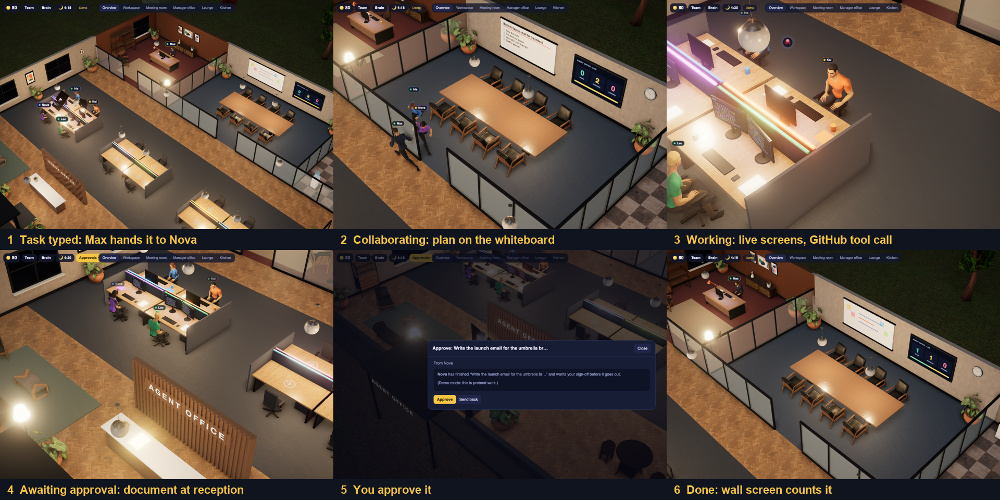

# Agent Office

An isometric office where every desk belongs to an AI team member who works for you.
Ask Guardiola, the manager; he splits your request into jobs, briefs the team (in the meeting room when it takes two or more people),
they work at their desks with Claude, and bring the result back to his office.
Finished jobs earn coins. Coins hire more people, upgrade desks (more screens, and that person thinks harder) and teach skills.

## Run it

    npm install
    npm start

Then open http://localhost:5173

The Vercel build serves the public demo with simulated agents. Office progress is temporary and can be shared between visitors served by the same instance. Run the local server to use live providers, save reports, and edit the Brain.

The Vercel build (`npm run build:vercel`) bundles and minifies the page's JavaScript with three.js into one cached file and serves the team list as a static file. If you add new images or models, run `python3 tools/optimize-assets.py` (needs Pillow) to shrink them before committing.

Profile pictures are drawn from Open Peeps by Pablo Stanley (CC0: no copyright, free for any use) and coloured to match each person's look. After changing the team in `config/agents.yaml`, run `node tools/make-avatars.js` to redraw them; anyone without a picture gets a portrait rendered from their 3D model.

### Connecting the AI (OmniRoute, free providers)

The team thinks through [OmniRoute](https://github.com/cheaper-inference/OmniRoute), a local gateway to many AI providers, several with free tiers.

1. Start it: `omniroute` (dashboard at http://localhost:20128, listening only on this Mac).
2. In its dashboard, **Providers**: connect the providers you have accounts with.
3. **Endpoints**: create an API key and paste it after `OMNIROUTE_API_KEY=` in this folder's `.env`. The game notices within about 20 seconds.
4. In the game, click a person and pick their **Model**. `auto` lets OmniRoute choose; give Guardiola (the manager) your strongest model, since he plans every mission.

Until a provider is connected the office runs in **demo mode**: everything moves, but the work is placeholder text.
To use the Anthropic API instead, set `AI_BACKEND=anthropic` and `ANTHROPIC_API_KEY` in `.env`. Web search and Page reader skills only work on that backend.

## What is in the office

- **Rooms** (tabs at the top): Workspace, Meeting room, Manager office, Lounge, Kitchen. Between jobs people take breaks in the kitchen and lounge.
- **Team** (top bar): Guardiola (head), then the people listed in `config/agents.yaml`. Click an empty desk (marked with a small +) to hire.
- **Time of day**: the light follows Darwin's clock: sun by day, warm sunset, lamps and stars at night. Click the clock in the top bar to preview other times.
- **Skills**, taught with coins, are real abilities: *Web search*, *Page reader* (opens web pages) and *Brain*.
- **Brain** (top bar): the shared memory browser (see below).

## How a task runs

1. You type a task. **Guardiola** (the head) plans it: who does what, which steps depend on others, and which results go out and so need your approval. He only uses people who are hired, and never more than five jobs.
2. With two or more people involved they meet in the meeting room and the plan goes on the whiteboard.
3. Each person works at their desk. Steps that do not depend on each other run at the same time.
4. **Modrić** (QA) checks every output. If he fails it, the writer gets his notes and rewrites it once.
5. Anything marked as going out waits as a glowing document at reception until you approve it.
6. Guardiola merges the results into one report (saved in `reports/`).

Safety: every model call has a two-minute timeout, calls are spaced out and rate limits are waited out (`OMNIROUTE_GAP_MS` in `.env`), and each call is logged to `data/calls.jsonl` (who, which model answered, time, tokens). `GET /api/usage` totals today's calls per person. Nobody on the free models can browse the web, so they are told never to present job listings, links or prices as real.

Models are OmniRoute **combos** (`max-brain`, `researcher`, `coder`, `writer`, `reviewer`): ordered lists with fallbacks, edited in the OmniRoute dashboard. Pick a model per person on their card, or choose "Default" to follow `config/agents.yaml`.

## Token bar

The **⚡** bar in the top bar shows tokens used today against a daily budget (`DAILY_TOKEN_BUDGET` in `.env`, 300k by default). Click it for tokens per person and per model, failed calls, tokens per call, and the last seven days, so you can see whether changes make the team cheaper. It reads `data/calls.jsonl`; when a route does not report usage, tokens are estimated from text length.

## Checking models

Free routes in use: OmniRoute's DuckDuckGo route (`ddgw/*`) and Cloudflare playground (`cfp/*`, needs `npx playwright install chromium` in OmniRoute's folder, done). Both are unofficial and can be blocked for a while; each combo lists models from both so one route being down does not stop the office. Instructions are sent inside the user message because the Cloudflare route ignores system messages.

OmniRoute lists hundreds of models, but only those whose provider is set up actually answer.
- **Test** on anyone's card sends a tiny request to their model and shows ✓ with the time, or ✗ with a one-line reason.
- **Find working models** checks your combos and one model per provider in the background (paced, about a minute), then checks more from providers that answered. Results are cached in `data/model-tests.json`; the model list shows ✓ ones first and ✗ ones last.
- On start, everyone's model is checked once. A red banner names anyone with no working model, and pretend tasks are labelled **DEMO** so they are never mistaken for real work.
- If a model fails during a task (or is simply not set up), that step retries once on the quickest model that answered recently, and the chat says which model was used instead.

## The Brain (shared memory)

Memory lives in `data/brain/` as plain files, handled by `brain.js`:
- `profile.md`: who you are, your business, goals and tone. Always sent to Guardiola.
- `memories.json`: facts, decisions and lessons, each with category (you, business, projects, lessons), source task, agent, date and a normal or private flag.
- `stats.json`: reads and writes today, for the wall screen.

**On every task:** Guardiola gets the profile plus the few memories that match the task (simple keyword search, a fixed size budget). Each worker gets only the few that match their step. After the task, Guardiola proposes up to three things worth keeping, Modrić checks each one (true, lasting, not a duplicate, nothing sensitive), and only approved ones are saved. If Modrić is unsure it appears at reception for you to decide. Secrets, card, ID and bank numbers are refused in code whatever a model says.

**Privacy:** memories marked private are only sent to models listed under `trusted_models` in `config/agents.yaml` (empty by default). Everything else goes to whichever provider serves that call.

**In the office:** the glass **Brain** room east of the kitchen. Each saved memory is a glowing cube on its category rack; a read sends a light beam from the core to that desk and flashes the cubes used; a write flies into the core and a new cube appears; the core pulses on every model call; the wall screen shows memories, reads and writes today and the top user. Click the core or the **Brain** button to search, edit, make private or delete anything (and edit the core profile). API: `GET /api/brain`, `PATCH` and `DELETE /api/brain/:id`.

## The office reacts to agent events

Everything the office shows comes from one stream of events, defined in `public/js/agentEvents.js`:
task assigned (a card flies from Guardiola to the desk), working (the person sits, the monitors show live output), tool call (an icon pops over the desk),
collaborating (people meet, the plan goes on the whiteboard), awaiting approval (a glowing document lands on the reception counter; click it or the
Approvals button), error (red desk light, they go to QA), done (the card goes back to Guardiola and onto the wall screen), and idle (breaks).

Three sources produce those events, and the scene does not care which:
- **Mock**: realistic pretend tasks every 20 seconds, used when no AI is connected. Typed tasks run through it too.
- **Server**: this project's own manager-and-team pipeline (OmniRoute or the Anthropic API), used when an AI is connected.
- **WebSocket**: open the game as `http://localhost:5173/?ws=ws://your-backend/events` and send the same JSON events from any backend, LangGraph included.

## Where things are

- `server.js` – web server, save file, and the manager/team prompts
- `brain.js` – the shared memory (recall, remember, forget, privacy rules)
- `config/agents.yaml` – the team: each person's role, system prompt, OmniRoute model or combo, and allowed tools (restart after editing)
- `public/js/config.js` – game rules: costs, rewards, skills
- `public/js/office.js` – floor plan, furniture, desks, walking grid
- `public/js/people.js` – the people: bodies, hair, clothes, animations
- `public/js/agentEvents.js` – the event format, the mock generator and the server and websocket sources
- `public/js/game.js` – how the office reacts to events, camera, cards, chat
- `data/city.json` – your save (delete it to start over); `reports/` – every finished mission as Markdown
- `tools/itch-get.sh` – downloads the free files of an itch.io asset page

## Credits (all CC0 / public domain)

- People, hair and animations: Universal Base Characters and Universal Animation Library by Quaternius (quaternius.itch.io)
- Trees, bushes, rocks and flowers: Stylized Nature MegaKit by Quaternius
- Furniture, plants and the floor, wall and wood textures: Poly Haven (polyhaven.com), fetched with `tools/polyhaven-get.py`
- Desks, office chairs, monitors, kitchen units and the pool table are built in code

## The courts

When a player has no work, they sometimes walk out through the lounge's side door to the courts east of the office. There is a 3-a-side football pitch with goals, and a half basketball court where players take turns shooting. The keeper (Neuer, gloves and #1) always takes a goal, and the others play in front of him. A new task sends a player straight back to their desk. The Courts tab jumps the camera there.

## Personalities

Each player has `celebrate` (a move: cheer, jump or dance, plus a line) and `lines` (things they say) in `config/agents.yaml`. When they finish a job they usually stand up beside their desk and celebrate. A goal on the pitch gets the same celebration. On breaks and on the courts they say their lines now and then. The coach does not sit still: he watches football from the touchline and stands behind whoever is working, calling out his own lines.

## Real work: what the team can and cannot do

- **Web search** needs a free key from an official search API. Add one line to `.env` and restart:
  - `TAVILY_API_KEY=tvly-...` from tavily.com (made for AI agents, free monthly allowance), or
  - `BRAVE_API_KEY=...` from the Brave Search API.
  Then the planner writes search queries for each research job, the server runs them, reads the top pages, and hands the text to whoever has the **Web search** skill. QA checks that every price or listing names one of those pages. Without a key, nobody pretends to search: they say what they need instead.
- **Free routes cut long replies short.** The server notices (`finish_reason: length`) and asks the same model to carry on, up to four times.
- **Doubled text** from the Cloudflare route (each chunk sent twice) is merged back automatically.
- **QA reviews each job only against its own brief**, not the whole request.

## Activity log

The **Log** button opens a live feed: who got which job, every web search and page read, QA passes and send-backs, approvals, Brain reads and saves, errors, and office life (breaks, games, goals, the coach on the touchline). Filter it with All / Work / Office life.
